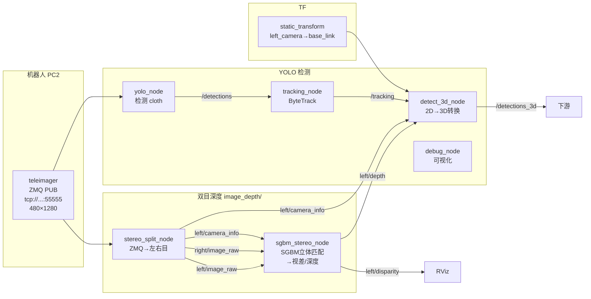

# YOLO + 双目深度 3D 检测使用说明

> **系统**: ROS2 Humble + Python 3.10  
> **位置**: `/home/unitree/YOLO_ws/image_depth/`  
> **YOLO 环境**: `YOLO` (Conda) — 需 numpy<2  
> **图传环境**: `teleimager` (Conda)

---

## 目录

1. [系统架构](#1-系统架构)
2. [文件说明](#2-文件说明)
3. [环境准备](#3-环境准备)
4. [完整启动流程](#4-完整启动流程)
5. [相机标定](#5-相机标定)
6. [查看结果](#6-查看结果)
7. [常见问题](#7-常见问题)

---

## 1. 系统架构



### 数据流

| 步骤 | 节点 | 输入 | 输出 |
|------|------|------|------|
| ① | `stereo_split_node` | ZMQ 双目流 (480×1280) | `left/image_raw`, `right/image_raw` |
| ② | `sgbm_stereo_node` | 左右目图像 + CameraInfo | `left/disparity`, `left/depth` |
| ③ | `yolo_node` | ZMQ 双目流 → 裁切左半 | `/yolo/detections` |
| ④ | `tracking_node` | detections | `/yolo/tracking` (带 ID) |
| ⑤ | `detect_3d_node` | tracking + depth + camera_info | `/yolo/detections_3d` (3D 坐标) |
| ⑥ | `debug_node` | detections_3d + image | `/yolo/dbg_image` (可视化) |

---

## 2. 文件说明

所有文件位于 `/home/unitree/YOLO_ws/image_depth/`：

| 文件 | 说明 |
|------|------|
| `stereo_split_node.py` | 从 ZMQ 接收双目图像，拆分左右目发布到 ROS2 |
| `sgbm_stereo_node.py` | 纯 Python SGBM 立体匹配，输出视差和深度 |
| `disparity_to_depth_node.py` | (备用) 视差→深度转换节点 |
| `calibrate_stereo.py` | 双目相机标定脚本 |
| `run_stereo_yolo.sh` | 一键启动脚本 |
| `checkerboard_9x7_25mm.png` | 棋盘格标定板 (打印用) |
| `calibration_result.yaml` | 标定结果 |
| `calib_samples/` | 标定过程中的样本图像 |

---

## 3. 环境准备

### 3.1 前置条件

```bash
# teleimager 已在运行 (提供 ZMQ 图传)
ps aux | grep teleimager

# 安装依赖 (teleimager 环境)
conda activate teleimager
pip install zmq opencv-python numpy

# 安装 stereo_msgs (已安装可跳过)
sudo apt install ros-humble-stereo-msgs

# 安装标定工具 (仅标定时需要)
sudo apt install ros-humble-camera-calibration
```

### 3.2 numpy 兼容性

YOLO 环境需要 numpy<2 以兼容 ROS cv_bridge:

```bash
conda activate YOLO
pip install "numpy<2"
```

验证:

```bash
python3 -c "import numpy; print(numpy.__version__); import cv2; print('cv2 OK'); from cv_bridge import CvBridge; print('cv_bridge OK')"
```

---

## 4. 完整启动流程

### 4.1 一键启动 (推荐)

```bash
conda activate teleimager
cd ~/YOLO_ws/image_depth
bash run_stereo_yolo.sh
```

### 4.2 分步启动

**终端 1 — 双目拆分:**

```bash
conda activate teleimager
cd ~/YOLO_ws/image_depth
python3 stereo_split_node.py
```

**终端 2 — SGBM 立体匹配:**

```bash
conda activate teleimager
cd ~/YOLO_ws/image_depth
python3 sgbm_stereo_node.py
```

**终端 3 — 静态 TF:**

根据机器人 URDF，头部双目相机安装于 D435 前方，相对骨盆 (`pelvis`/`base_link`) 的位置为:

| 方向 | 偏移量 |
|------|--------|
| 向前 (x) | 0.054 m (5.4 cm) |
| 向左 (y) | 0.018 m (1.8 cm) |
| 向上 (z) | 0.474 m (47.4 cm) |
| 俯仰 | ~47° (朝下看) |

```bash
source /opt/ros/humble/setup.bash
ros2 run tf2_ros static_transform_publisher \
    0.054 0.018 0.474 -0.383 0 0 0.924 \
    left_camera base_link
```

> 四元数 `(-0.383, 0, 0, 0.924)` 对应俯仰 45° 朝下的相机光轴方向 (ROS 相机坐标系: z=前, x=右, y=下)。如需精确数值，可用尺子测量实际安装位置后修正。

**终端 4 — YOLO 3D 检测:**

```bash
source /opt/ros/humble/setup.bash
source ~/YOLO_ws/install/setup.bash
conda activate YOLO

ros2 launch yolo_bringup yolo.launch.py \
    use_3d:=True \
    use_tracking:=True \
    use_debug:=True \
    input_depth_topic:=/left/depth \
    input_depth_info_topic:=/left/camera_info \
    depth_image_units_divisor:=1 \
    target_frame:=base_link \
    threshold:=0.5 \
    model:=~/YOLO_ws/models/best.pt
```

### 4.3 验证运行

```bash
# 查看所有话题
ros2 topic list | grep -E "^/left|^/yolo"

# 确认关节状态 (若已启动 robot_state_publisher)
ros2 topic echo /joint_states --once | head -5
```

### 4.4 查看机器人模型 (RViz)

在终端中运行以下命令，可在 RViz 中显示 G1 机器人 URDF 模型，直观看到 YOLO 检测到的物体相对于机器人本体的位置：

```bash
cd ~/YOLO_ws/image_depth
bash view_g1_urdf.sh
```

#### 机器人端 (无显示器) + PC 端 (有显示器) 配合使用

由于机器人 NX 主板没有连接显示器，RViz 需要分两步：

**步骤 1 — 在机器人端启动 ROS 节点（headless 模式）：**

```bash
cd ~/YOLO_ws/image_depth
bash view_g1_urdf.sh --headless
```

这会启动 `g1_lowstate_to_joint_states`、`robot_state_publisher` 和 `pelvis → base_link` 静态 TF，但不启动 RViz。

**步骤 2 — 在你的 PC 上启动 RViz：**

在 PC 的终端中（确保 PC 与机器人在同一网络，ROS_DOMAIN_ID 一致）：

```bash
source /opt/ros/humble/setup.bash
source ~/YOLO_ws/install/setup.bash    # 可选，使 yolo_msgs 类型可用

# 启动 RViz（需要 PC 有显示器）
ros2 run rviz2 rviz2 -d g1_urdf.rviz
```

> PC 端需要将 `g1_urdf.rviz` 配置文件复制过去，或使用共享目录。
>
> 若 PC 上没有 `g1_urdf.rviz`，也可手动配置：添加 RobotModel 显示项，Description Topic 选择 `/robot_description`，Fixed Frame 设为 `base_link`。

**停止节点：**

在机器人端运行：

```bash
cd ~/YOLO_ws/image_depth
bash view_g1_urdf.sh --stop
```

脚本会依次启动：
1. **g1_lowstate_to_joint_states** — 将机器人的 `/lowstate` 转为标准 `/joint_states`
2. **robot_state_publisher** — 加载 G1 URDF 模型，发布所有 link 的 TF 变换
3. **pelvis → base_link 静态 TF** — 连接 URDF 根 link 与 3D 检测参考系
4. **RViz2** — 显示机器人 3D 模型 + TF 树

> **注意**：该脚本依赖 `/lowstate` 话题（来自 Unitree SDK，需机器人在线）。若机器人未连接，模型将显示在初始姿态（站立姿态，关节角度为零）。

RViz 启动后：
- **Fixed Frame** 已设为 `base_link`（与 YOLO 3D 检测输出一致）
- 左侧 **Displays** 面板中已添加 **RobotModel** 和 **TF** 显示项
- 可手动添加 `/yolo/dbg_image/compressed`（Image）或 `/yolo/dgb_bb_markers`（MarkerArray）查看检测结果

```bash
# 查看所有话题
ros2 topic list | grep -E "^/left|^/yolo"

# 确认深度数据
ros2 topic echo /left/depth --once | head -5

# 确认 3D 检测结果
ros2 topic echo /yolo/detections_3d --once
```

期望输出:

```yaml
header:
  stamp: ...
  frame_id: zmq_left_camera
detections:
- class_name: cloth
  score: 0.92
  id: '1'
  bbox2d:
    center: {x: 304, y: 341}
    size: {x: 411, y: 265}
  bbox3d:
    center: {x: -0.31, y: 0.09, z: 0.01}   # ← 相对于 base_link(米)
    size:   {x: 0.47, y: 0.30, z: 0.59}
    frame_id: base_link
```

---

## 5. 相机标定

### 5.1 打印标定板

标定板文件: `~/YOLO_ws/image_depth/checkerboard_9x7_25mm.png`

- 规格: 10×8 格, 9×7 内角点, 每格 25mm
- **白底黑格**，用 A4 纸打印 (100% 原尺寸，不要缩放)
- 纸张尽量平直不褶皱

### 5.2 运行标定

```bash
# 终端 1: 启动双目拆分
conda activate teleimager
cd ~/YOLO_ws/image_depth
python3 stereo_split_node.py

# 终端 2: 启动标定
conda activate teleimager
cd ~/YOLO_ws/image_depth
python3 calibrate_stereo.py
```

### 5.3 操作步骤

拿着棋盘格放在**机器人头部相机前**，缓慢变换各种姿态:

| 姿态 | 说明 |
|------|------|
| 正面 | 棋盘格正对相机，左右目都能看到 |
| 左右倾斜 | 左右各 30~45° |
| 上下俯仰 | 上下各 30~45° |
| 远近 | 从 20cm 到 100cm 距离 |
| 旋转 | 平面内旋转棋盘格 |

终端会显示检测进度:

```
✓ 第  1/40 帧  检测到棋盘格!  (1 帧已收集)
✓ 第  2/40 帧  检测到棋盘格!  (2 帧已收集)
...
```

收集 25~40 帧后自动完成标定，结果保存到 `calibration_result.yaml`。

### 5.4 更新标定参数

标定完成后将结果更新到 `stereo_split_node.py`:

```python
# stereo_split_node.py 中的默认参数
FX_DEFAULT = 297.9       # 左目焦距 fx
FY_DEFAULT = 297.9       # 左目焦距 fy
CX_DEFAULT = 319.5       # 主点 x
CY_DEFAULT = 239.5       # 主点 y
BASELINE_DEFAULT = 0.0426 # 基线 (米)
```

或者通过参数传入:

```bash
python3 stereo_split_node.py \
    --ros-args \
    -p fx:=297.9 -p fy:=297.9 \
    -p cx:=319.5 -p cy:=239.5 \
    -p baseline:=0.0426
```

---

## 6. 查看结果

### 6.1 命令行

```bash
# 2D 检测
ros2 topic echo /yolo/detections

# 3D 检测 (含相对于 base_link 的 3D 坐标)
ros2 topic echo /yolo/detections_3d

# 深度图
ros2 topic echo /left/depth --once

# 视差图 (RViz Stereo 可显示)
ros2 topic echo /left/disparity --once
```

### 6.2 RViz 可视化

在 PC 上 (有显示器) 查看机器人模型和检测结果。

#### 快速启动（机器人端 + PC 端配合）

**机器人端（headless 模式）：**

```bash
cd ~/YOLO_ws/image_depth
bash view_g1_urdf.sh --headless
```

**PC 端（启动 RViz）：**

```bash
source /opt/ros/humble/setup.bash
source ~/YOLO_ws/install/setup.bash    # ← 必须! 否则找不到 yolo_msgs 类型

# 启动 RViz
ros2 run rviz2 rviz2
```

#### PC 端单独启动 RViz（已有节点在运行）

```bash
source /opt/ros/humble/setup.bash
source ~/YOLO_ws/install/setup.bash    # ← 必须! 否则找不到 yolo_msgs 类型
ros2 run rviz2 rviz2
```

#### 查看机器人模型 + 检测结果

先用 `view_g1_urdf.sh` 启动机器人模型显示（包含 robot_state_publisher + TF 桥接）：

```bash
cd ~/YOLO_ws/image_depth
bash view_g1_urdf.sh
```

推荐添加的显示项:

| 显示 | 类型 | 话题 | 说明 |
|------|------|------|------|
| 机器人模型 | RobotModel | `/robot_description` | G1 机器人 3D 模型 |
| TF 树 | TF | `/tf` | 查看各 link 坐标系 |
| 检测画面 | Image | `/yolo/dbg_image/compressed` | YOLO 检测可视化 **(用压缩版!)** |
| 左目图像 | Image | `/left/image_raw/compressed` | 左相机画面 **(用压缩版!)** |
| 右目图像 | Image | `/right/image_raw` | 右相机画面（仅原始版） |
| 深度图 | Image | `/left/depth/compressed` | 深度图 **(用压缩版!)** |
| 视差图 | Stereo | `/left/disparity` | 双目视差 |
| 3D 边界框 | MarkerArray | `/yolo/dgb_bb_markers` | 3D 检测框 |
| 3D 关键点 | MarkerArray | `/yolo/dgb_kp_markers` | 3D 关键点 |

> **⚠️ 重要：网络带宽优化**
>
> 所有图像话题都提供了 **压缩版** (`/compressed` 后缀)，请务必在 RViz 中使用压缩版，
> 否则全尺寸原始图像会占用大量网络带宽导致卡顿：
>
> | 话题 | 原始大小 (每帧) | 压缩后 (每帧) |
> |------|:--------------:|:-------------:|
> | `/left/image_raw` | ~900KB | ~15-30KB |
> | `/left/depth` (32FC1) | ~1.2MB | ~5-15KB |
>
> - 用 `/left/image_raw/compressed` 而非 `/left/image_raw`
> - 用 `/left/depth/compressed` 而非 `/left/depth`
> - 用 `/yolo/dbg_image/compressed` 而非 `/yolo/dbg_image`
>
> 在 RViz 中添加 Image 显示项时，在 **Image Topic** 下拉框中直接选择带 `/compressed` 的版本即可。

RobotModel 显示项添加后，可在左侧 **Displays** → **RobotModel** → **Description Topic** 中选择 `/robot_description`。模型将以 `base_link` 为参考系显示，与 YOLO 3D 检测输出的坐标系一致，从而直观看到物体与机器人的相对位置。

> **排查提示**：如果 RobotModel 显示为红色/报错 `No transform`，说明 TF 树断裂。确保以下节点均在运行：
> - `g1_lowstate_to_joint_states`（将 `/lowstate` → `/joint_states`）
> - `robot_state_publisher`（加载 URDF 发布 link TF）
> - `static_transform_publisher pelvis → base_link`（连接 URDF 根 link 与检测参考系）
> - 已有 `static_transform_publisher left_camera → base_link`（由 `run_stereo_yolo.sh` 启动）

### 6.3 下游使用

`/yolo/detections_3d` 中的 `bbox3d` 包含:

```python
# 物体相对于 base_link 的 3D 坐标 (米)
position_x = det.bbox3d.center.position.x
position_y = det.bbox3d.center.position.y
position_z = det.bbox3d.center.position.z

# 物体尺寸 (米)
width  = det.bbox3d.size.x
height = det.bbox3d.size.y
depth  = det.bbox3d.size.z
```

可用于抓取、避障等下游任务。

---

## 7. 常见问题

### Q: 找不到 `yolo_msgs` 消息类型

```bash
# 在运行 ros2 topic echo / ros2 run rviz2 之前先 setup
source ~/YOLO_ws/install/setup.bash
```

### Q: cv2 / cv_bridge 导入报错 `_ARRAY_API not found`

numpy 版本冲突，在 YOLO 环境中降级:

```bash
conda activate YOLO
pip install "numpy<2"
```

### Q: 立体匹配没有输出

检查 topics 是否正常发布:

```bash
ros2 topic list | grep left
# 应有: left/image_raw, right/image_raw, left/camera_info
```

### Q: `detect_3d_node` 报 "Could not transform"

TF 树未发布。确保 static_transform_publisher 在运行:

```bash
ros2 run tf2_ros static_transform_publisher \
    0.054 0.018 0.474 -0.383 0 0 0.924 left_camera base_link
```

### Q: 3D 坐标不准确

原因及解决方案:

| 原因 | 解决 |
|------|------|
| 相机未标定 | 执行第 5 节标定流程 |
| 基线不准确 | 更新 `BASELINE_DEFAULT` |
| TF 位置不对 | 测量相机安装位置更新 static_transform |
| 标定误差大 | 重新标定，确保棋盘格覆盖更多姿态 |

### Q: 重启节点后报 "publisher's context is invalid"

旧 rclpy 上下文残留，等几秒重试即可:

```bash
sleep 3
python3 sgbm_stereo_node.py
```

### Q: RViz 中 RobotModel 显示为红色 / "No transform"

TF 树断裂导致 robot_state_publisher 无法计算所有 link 的坐标变换。检查:

```bash
# 查看 TF 树
ros2 run tf2_ros tf2_monitor

# 确认 joint_states 在发布
ros2 topic echo /joint_states --once | head -3

# 确认必要的静态 TF 都存在
ros2 topic echo /tf_static --once
```

保证以下节点均在运行:
1. `g1_lowstate_to_joint_states` — 将 `/lowstate` 转为 `/joint_states`
2. `robot_state_publisher` — 加载 URDF，发布 link TF
3. `static_transform_publisher 0 0 0 0 0 0 0 pelvis base_link` — 连接 URDF 与检测参考系

也可直接运行 `bash view_g1_urdf.sh` 一键启动以上所有节点。

### Q: `view_g1_urdf.sh` 报 "找不到 g1_lowstate_to_joint_states"

确保 unitree_ros2 的 example overlay 已编译。编译方式:

```bash
cd ~/gb_repositories/unitree_ros2/example
colcon build --packages-select unitree_ros2_example
source install/setup.bash
```
